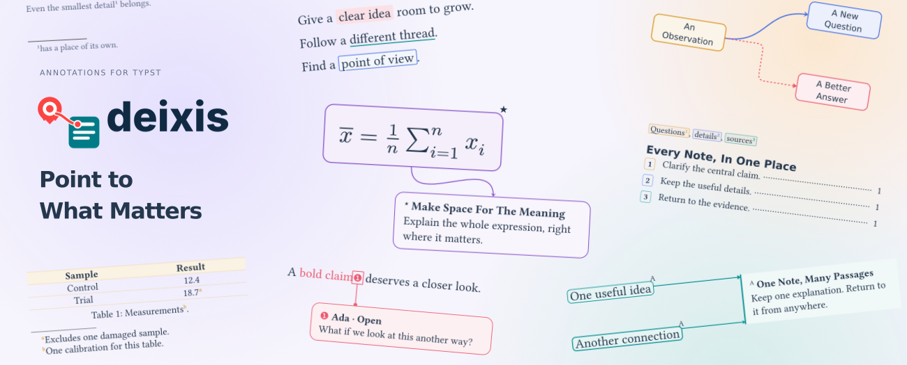
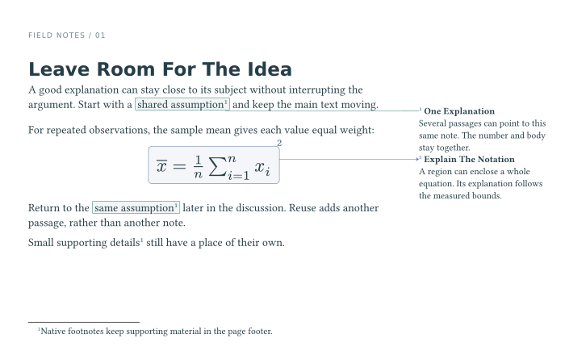
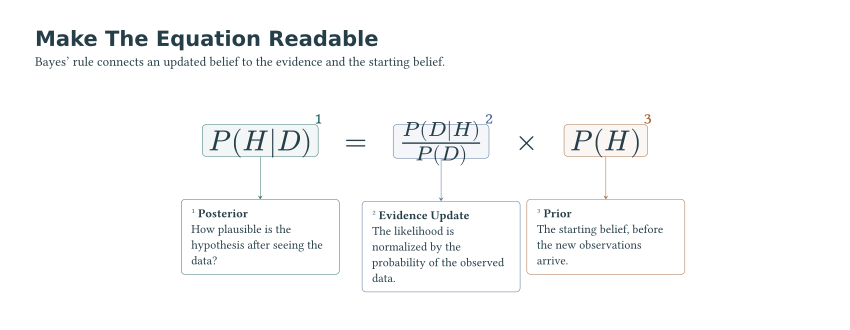
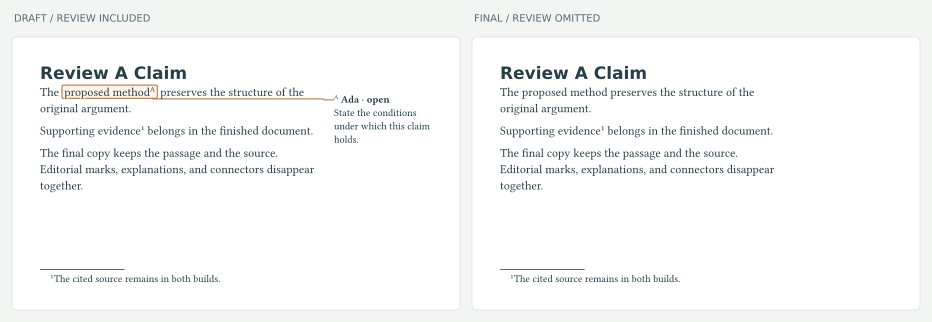

# Deixis

[](https://typst.app/universe/package/deixis)
[](LICENSE)



**Notes, highlights, and connections for Typst.** Keep explanations beside their
subjects, share one note across several passages, or connect the parts of an
image, equation, or diagram. Use it in articles, edited texts, and presentation
slides.

[Get started](docs/guides/getting-started.md) · [Read the guide](docs/README.md) ·
[PDF manual](docs/manual.pdf?raw=true) · [Browse examples](examples/)

> **Development checkout:** this README describes unreleased **0.2.0**, requiring
> **Typst 0.15.0+**. Universe currently serves **0.1.1**. [Install the checkout](#install-the-checkout)
> before trying these examples.

## Start With A Note

```typst
#import "@preview/deixis:0.2.0": *
#show: deixis-setup-notes

A useful result#deixis-footnote[A short explanation.]
is easier to read when its details have a place.
```

Simple wrappers create the mark and explanation together. Choose native
footnotes, margin notes, inset callouts, inline explanations, or collected
endnotes. Connections and custom styling are optional.

For shorter calls, [import the optional `short` module](docs/guides/getting-started.md#optional-short-names)
and use `footnote`, `configure` and `note-block`, or qualified names such as
`dx.footnote`. Native `block` stays available.

## One Explanation, Several Passages



Name an annotation with `id:` and reuse it with `of:`. The passages share one
number and one body:

```typst
#deixis-margin-note(id: <assumption>, connector: "right-angle")[shared assumption][
  Several passages can point to this same note.
]
Return to the #deixis-mark(of: <assumption>)[same assumption] later.
```

A reused mark adds a navigation point rather than another note; add
`deixis-connect` when it also needs a drawn connection. Margin notes need room
beside the text; they pack, and can spill onto existing pages.

[Complete document](examples/annotated-reading.typ) ·
[Shared notes](docs/guides/shared-notes.md) · [Appearance](docs/guides/appearance.md)

## Explain The Equation



Regions follow the measured content. Add precise callouts to equations, code,
images, or tables; choose their colors and connectors independently. The
routing API also connects your own objects, with optional obstacle avoidance;
the diagram in the banner above uses it.

[Editable equation](examples/annotated-equation.typ) ·
[Regions and pins](docs/guides/regions.md) ·
[Connect your own objects](docs/guides/document-routing.md)

## Review In Draft, Read In Final



`deixis-comment` writes an editorial comment in its own `"review"` series, with
lettered markers that stay apart from source notes:

```typst
The #deixis-comment(author: "Ada", status: "open")[proposed method][
  State the conditions under which this claim holds.]
```

A final build omits that series while preserving the marked passage and the
document's other notes:

```typst
#deixis-set(omit: (series: ("review",)))
```

The comparison renders the same source twice, with `--input final=false` and
`--input final=true`. Author and status fields can also drive custom review lists.

[Editable review](examples/editorial-review.typ) ·
[Draft/final guide](docs/guides/review-comments.md) ·
[Editorial apparatus and glossaries](docs/guides/editorial-recipes.md)

## Install The Checkout

```sh
git clone https://github.com/inspiros/typst-deixis
cd typst-deixis
python3 scripts/install.py --namespace preview --link --reinstall
```

This installs the development version for Typst CLI and VS Code/Tinymist while
keeping the old `0.1.1` cache separate. Omit `--link` for a copied installation.
See [installation](docs/guides/installation.md) for editor setup and alternatives.

## Go Further

| Task | Guide |
| --- | --- |
| Pick a note type and placement | [Getting started](docs/guides/getting-started.md) · [Body ownership](docs/guides/ownership.md) |
| Keep notes with tables or figures | [Local collections](docs/guides/blocks.md) · [Scopes](docs/guides/scopes.md) |
| Annotate presentation reveals | [Touying integration](docs/guides/rendering.md#presentation-frameworks) |
| Restart markers per page or reset counters | [Counters](docs/guides/counters.md) |
| Build annotation lists and indexes | [Queries](docs/guides/queries.md) · [Outlines](docs/guides/outlines.md) |
| Style notes or replace a renderer | [Configuration](docs/guides/configuration.md) · [Custom renderers](docs/guides/custom-renderers.md) |
| Update an older document | [Compatibility and migration](docs/guides/compatibility.md) |

The [PDF manual](docs/manual.pdf?raw=true) includes a guided introduction,
23 worked examples with source beside output, and a reference for every public API.
The local [mdBook website](docs/maintainers/website.md) shares those guides and
examples, with searchable API pages generated from source. The
[Deixis agent skill](skills/deixis/SKILL.md) includes checked authoring recipes.

For development, checks and artwork generation, see [CONTRIBUTING](CONTRIBUTING.md).
For an independent review, start with the [reviewer brief](docs/maintainers/review.md).

## Acknowledgements

Related work inspired parts of Deixis:
[drafting](https://github.com/ntjess/typst-drafting),
[dashy-todo](https://github.com/Otto-AA/dashy-todo),
[marge](https://github.com/EpicEricEE/typst-marge),
[pinit](https://github.com/OrangeX4/typst-pinit), and
[Rik's endnotes implementation](https://forum.typst.app/t/an-endnotes-implementation-with-headings-and-cross-referencing/7760).

## License

MIT licensed; see [LICENSE](LICENSE). Report bugs or suggest improvements on
[GitHub](https://github.com/inspiros/typst-deixis/issues).
