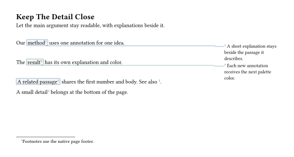

# Your First Annotations

Deixis separates a marked passage from its explanation. A simple note wrapper
creates both; a public name lets several passages share the same explanation.
Connections can be added when they help the reader follow that relationship.

This guide describes the **unreleased 0.2.0 checkout**, with **Typst 0.15.0+**.
Install its local preview override first:

```sh
python3 scripts/install.py --namespace preview --link --reinstall
```

Run this from the repository. The examples import `@preview/deixis:0.2.0`;
that version is not yet on Typst Universe. The override is visible to Typst CLI
and Tinymist. See [installation](installation.md) for alternatives.

## 1. Start With Native Footnotes

```typst
#import "@preview/deixis:0.2.0": *
#show: deixis-setup-notes

A useful result#deixis-footnote[A short explanation.]
is easier to read when its details have a place.
```

`deixis-setup-notes` installs annotation registration and rendering. Footnotes
use the native page footer, so long ones paginate like `std.footnote`. Omit
`id:` when you do not need to refer to an annotation elsewhere.

## 2. Put Explanations In The Margin

Give the page a wide margin and let the note follow its marked passage:

```typst
#import "@preview/deixis:0.2.0": *
#set page(margin: (left: 25mm, right: 50mm, y: 25mm))
#show: deixis-setup-notes

Our #deixis-margin-note(id: <method>, width: 38mm, side: right,
  connector: "right-angle",
)[method][The explanation stays beside the passage it describes.]
keeps the main text short.
```

The first content argument is the marked passage; the second is the body.
A single content argument creates a solo numbered mark with that content as its
body. `connector:` adds an optional connector; omit it for a plain margin note.
Default overlay margin notes pack together and may spill onto existing pages.



Open [First Notes](../../examples/first-notes.typ) for the complete rendered
example, including a palette and a reused passage.

## Unnumbered Asides

Make margin and inset notes unnumbered while footnotes and endnotes keep their
own 1, 2, 3 sequences:

```typst
#deixis-set(numbering: (margin-note: none, inset-note: none))
```

These asides take no counter value. A [palette](appearance.md), configured with
`deixis-set(palette: ...)`, or a connector helps readers pair passages with their
unnumbered notes. Use `numbering: none` on one call for a single aside.
`marker: none` alone only hides its marker and still consumes a number.

## 3. Share A Body Or Declare It Elsewhere

After creating `<method>`, use `of:` to add another marked passage:

```typst
#deixis-mark(of: <method>)[A related passage] shares the same explanation.
See also @method.
```

An annotation has one original mark and at most one attached body.
A reused mark keeps the original's marker and adds a return-link origin.
It does not draw a new connector automatically. Set `backlink: true` on the original note/body
to display return links; use `deixis-connect` for additional drawn edges.

When the explanation is authored separately, declare the components directly:

```typst
#deixis-mark(id: <detail>)[A passage]
#deixis-margin-note-body(of: <detail>, width: 38mm, side: right)[One explanation.]
#deixis-mark(of: <detail>)[Another passage]
```

The body and reused marks may precede the original. Only `id:` creates the
original; another `id:` with the same spelling is an error. A
`-body(id: ...)` call instead creates a standalone body without a numbered mark.
See [identities](identities.md) for the complete rules.

The body's adapter decides where it appears. Overlay margins follow the original
mark; footnotes allocate space at the body declaration; inline bodies stay in
flow; endnotes appear at a printer. Forward lookup does not make all body types
follow a distant mark. See [body ownership](ownership.md).

## 4. Choose A Body And A Mark

| Explanation | Entry Point | Placement |
| --- | --- | --- |
| Page footnote | `deixis-footnote` | Native footer allocation at the body declaration; long bodies paginate |
| Margin note | `deixis-margin-note` | Beside the original passage, with overlay packing |
| Inset callout | `deixis-inset-note` | At its declaration by default, or at an explicit anchor/offset |
| Inline explanation | `deixis-inline-note` | An aside right after the passage, in the same sentence; `inline: false` gives a callout after the line |
| Collected endnote | `deixis-endnote` and `deixis-print-endnotes` | At an eligible printer |

Use `deixis-mark` for an inline passage or solo marker. Choose
`mark-type: "region"` to outline/highlight a region, or `"phantom"` for a
semantic anchor without visible decoration. Region examples cover formulas,
images, and pins in [regions and pins](regions.md).

## 5. Set A Consistent Appearance

```typst
#deixis-set(palette: "deixis")
```

Each new annotation gets one accent. Its reused marks and attached body retain
that accent; explicit styles still win. Place this before the annotations you
want to color. You can also pass an array of colors. See [appearance](appearance.md)
for all five named palettes, cycling and scoped palettes.

Use `deixis-set` for shared defaults. A `deixis-block` provides a local settings
scope; ordinary Typst brackets do not. Start with scalar defaults and use
component/type dictionaries when necessary. See [configuration](configuration.md).

## 6. Add Connections When Needed

For a margin/inset body, a route name is enough:

```typst
#deixis-margin-note(connector: "curve")[A short explanation.]
```

Structured options add heads or other controls as the drawing grows:

```typst
#deixis-margin-note(connector: (route: "curve", heads: (body: "stealth")))[
  An explanation with an arrow.
]
```

Connections use their own foreground overlay by default, independently of the
body's layer. Native arrowheads, exact waypoints, curved routes, optional cuts,
and custom painters are covered in [connectors](connectors.md).

For your own objects, use `deixis-attach(id: ...)` to register bounds where content
is drawn, `deixis-connect` for individual edges, and `deixis-routing` for a scoped
planning policy. Start with [routing objects in place](document-routing.md) and
its [small example](../../examples/routing-in-place.typ). This needs no note,
numbering, or second list of object positions.

## Optional Short Names

For frequent annotations, opt in to the `short` module:

```typst
#import "@preview/deixis:0.2.0": short
#import short: *
#show: setup-notes
#configure(stroke: teal)

Text#footnote[A short explanation.]
#note-block[Local#footnote[A local collection.]]
```

The aliases remove `deixis-`, with two exceptions: `configure` is
`deixis-configure` (also named `deixis-set`), and `note-block` is `deixis-block`.
`set` is a Typst keyword; native `block` remains untouched, including native
`set block(...)` rules. `minipage` is also available with its usual defaults.
These are the same functions, with the same parameters and behavior.

Wildcard imports deliberately shadow native `footnote` and `ref`. In math,
`attach` and `arrowhead` also resolve to Deixis; write `x^y` / `x_y`,
`std.math.attach(...)` or `std.sym.arrowhead` there. Use `std.footnote` / `std.ref` for
the native functions, or keep a namespace:

```typst
#import "@preview/deixis:0.2.0": short as dx
#show: dx.setup-notes
Text#dx.footnote[A short explanation.]
```

The reference uses prefixed names; the same entries describe their short aliases.

## Where To Go Next

For slides, read [Touying integration](rendering.md#presentation-frameworks),
[visibility](visibility.md), and [frame identities](touying-identities.md).
For documents, read [collected notes](collected-notes.md), [blocks](blocks.md),
and [references](references.md). To customize presentation, start with
[containers](containers.md), then [custom renderers](custom-renderers.md).
The [documentation index](../README.md) groups the remaining guides.

A few layout rules are worth knowing early. Overlay notes (the default for
margin notes) add no space to the text and can move to later pages, but cannot
create new ones. Flow placement (the default for inset notes) sits in the text
and can break a paragraph. Set native page backgrounds/foregrounds before setup,
and reapply setup after replacing them. Notes in headings work with outlines;
use [`deixis-plain`](outlines.md#repeated-headings) for running headers. See
[setup](setup.md) and [supported limits](compatibility.md) when integrating
with a theme or a complex layout.
